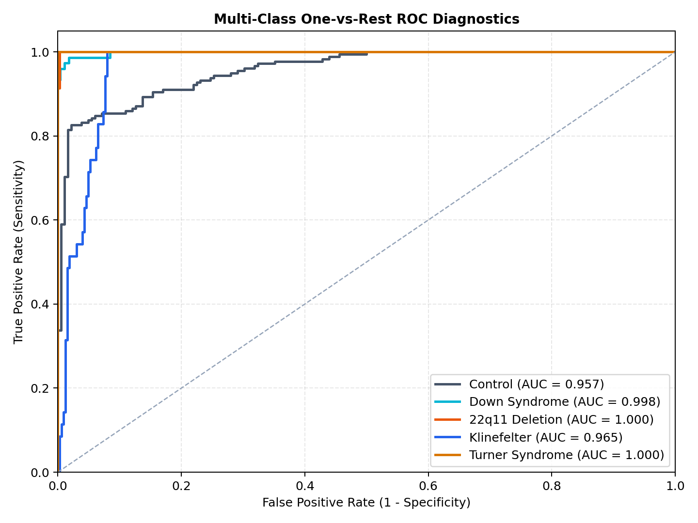
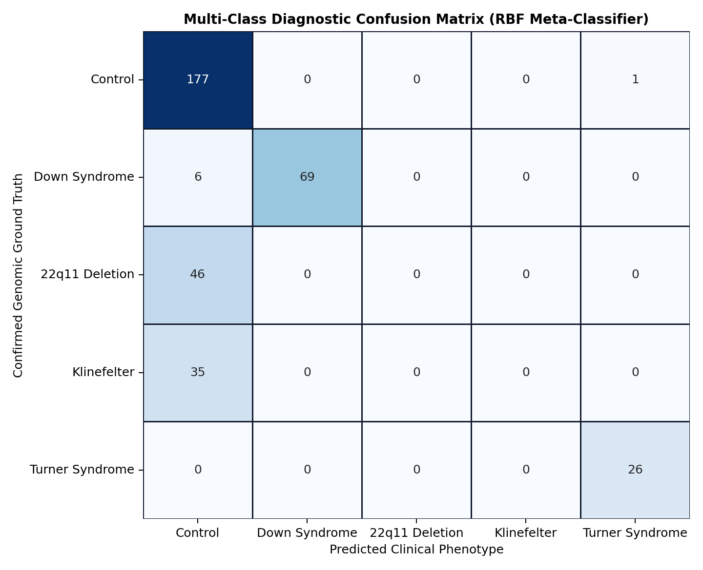
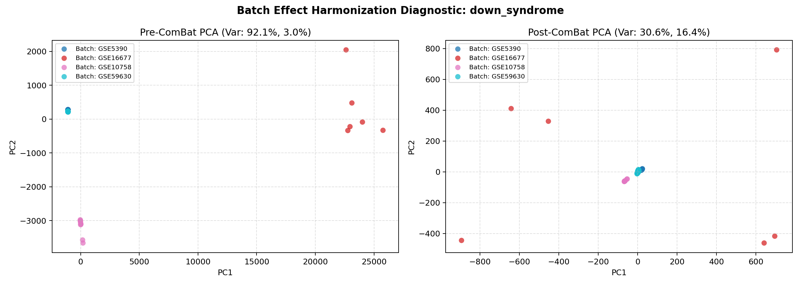
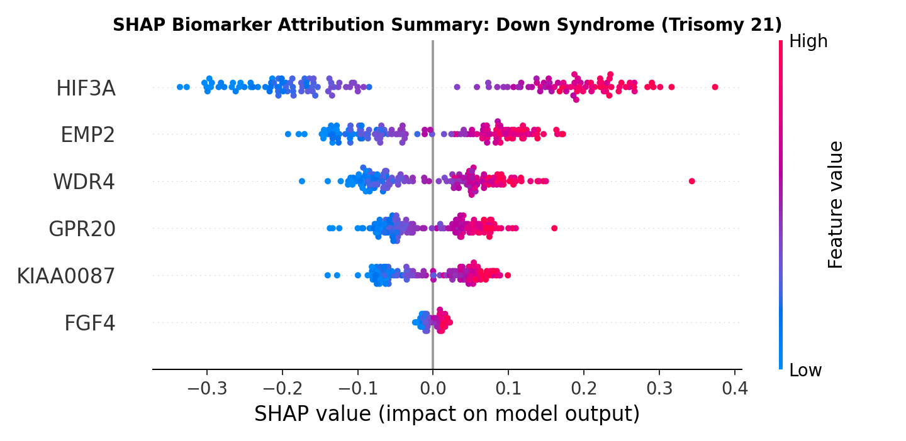

# Explainable Multi-Omics Framework for Genetic Syndrome Prediction

<div align="center">


### **Department of Computer Science & Engineering**
### **Amrita School of Computing, Coimbatore**
### **Capstone Technical Evaluation — Group 12**

[](https://developer.mozilla.org/en-US/docs/Web/HTML)
[](https://tailwindcss.com/)
[](https://katex.org/)
[](https://github.com/slundberg/shap)
[]()
[](LICENSE)

</div>

---

## 📖 Executive Summary & Problem Formulation

Genetic syndromes caused by chromosomal aneuploidies and microdeletions—such as **Trisomy 21 (Down Syndrome)**, **22q11.2 Deletion (DiGeorge Syndrome)**, **47,XXY (Klinefelter Syndrome)**, and **45,X (Turner Syndrome)**—result in profound transcriptomic disruptions across human gene expression networks. 

Conventional cytogenetic karyotyping and fluorescent in situ hybridization (FISH) are resource-intensive, laboratory-bound, and provide no dynamic mechanistic insight into functional downstream mRNA changes. Conversely, black-box artificial intelligence models are rejected in clinical settings due to their opacity and vulnerability to technical microarray batch variance.

This project delivers a **transparent, audit-ready clinical AI framework** that resolves the high-dimensional bottleneck ($p \approx 20,000 \gg n \approx 1,000$), removes inter-hospital batch effects using **Empirical Bayes ComBat**, performs sparse biomarker discovery via **$L_1$-regularized LASSO**, and provides **dual-level Shapley Additive Explanations (SHAP)** with a **live, fullscreen biophysical dosage mechanism simulator**.

---

## 👥 Project Team & Academic Credentials (Group 12)

| Student Name | Roll Number | Degree & Specialization |
| :--- | :--- | :--- |
| **HEMANTH** | `CB.AI.U4CPS25019` | B.Tech in Artificial Intelligence & Data Science |
| **NITHIN** | `CB.AI.U4CPS25033` | B.Tech in Artificial Intelligence & Data Science |
| **PRANESH DHANDAPANI** | `CB.AI.U4CPS25040` | B.Tech in Artificial Intelligence & Data Science |
| **VIKASH S S** | `CB.AI.U4CPS25054` | B.Tech in Artificial Intelligence & Data Science |

* **Institution**: Amrita Vishwa Vidyapeetham, Amrita School of Computing, Coimbatore  
* **Academic Evaluation**: Capstone Project Final Technical Review  
* **Master Presentation**: [`Explainable_MultiOmics_Syndrome_Prediction.pptx`](Explainable_MultiOmics_Syndrome_Prediction.pptx) (21 Slides with Grouped Math & SHAP)

---

## 🔬 Core System Architecture & Modules

```
                                    SYSTEM PIPELINE ARCHITECTURE
                                    
  [Raw GEO Microarrays] ──> [Affymetrix RMA Normalization] ──> [ComBat Empirical Bayes]
                                                                        │
  [Clinical Decision Web] <── [Dual SHAP Explanations] <── [L1-LASSO + RBF-SVM Engine]
             │
             ├── 1. Interactive 7-Stage Methodology Pipeline
             ├── 2. Fullscreen Biophysical Dosage Mechanism Simulator
             ├── 3. Diagnostic Tensor Workbench with Cohort Presets
             ├── 4. Self-Contained KaTeX Mathematical Formulations
             └── 5. Empirical Benchmark & Publication Gallery
```

### 1. End-to-End System Methodology Pipeline
- Interactive 7-stage pipeline tracker documenting every stage from raw GEO microarrays to clinical reporting.
- Stages covered: Raw Expression Curation $\to$ Affymetrix RMA Probe Summarization $\to$ ComBat Empirical Bayes Harmonization $\to$ $L_1$ LASSO Feature Sparsity $\to$ Dual-Space Support Vector Machine (RBF) $\to$ Game-Theoretic SHAP Attributions $\to$ Real-Time Clinical Decision Support.

### 2. Chromosomal Dosage Mechanism Simulation (with Immersive Fullscreen Mode)
- Real-time biophysical animation tracking how chromosomal nondisjunction alters transcription kinetics, reading frames, RNA Polymerase II elongation, mRNA saturation, and machine learning hyperplane separation.
- Features authentic NCBI/RefSeq nucleotide coding sequences (CDS Exon 1) for *APP*, *DYRK1A*, *TBX1*, *COMT*, *XIST*, and *SHOX*.
- **Fullscreen Mode**: Automatically maximizes on play (or via the `[ ⛶ Fullscreen ]` button / `F` key) with dynamic scaling of the SVG molecular canvas to 480px height.

### 3. Clinical Diagnostic Workbench & Dosage Simulator
- Interactive gene dosage sliders (*APP*, *DYRK1A*, *TBX1*, *COMT*, *XIST*, *SHOX*) with immediate recalculation of:
  - Local SHAP force contributions ($\phi_i$).
  - Support Vector Machine margin distance ($\mathbf{w}^T \phi(\mathbf{x}) + b$).
  - Multi-class diagnostic probability gauge and proteotoxic stress status.
- **Cohort Presets**: Instant loading for Down Syndrome, DiGeorge 22q11 Deletion, Klinefelter (47,XXY), Turner (45,X), and Healthy Diploid Controls.
- **Patient CSV Upload**: Direct drag-and-drop or file upload for patient expression profiles.

### 4. Self-Contained Mathematical Formulations
- Rigorous mathematical formulations rendered via KaTeX:
  - **ComBat Empirical Bayes**: Location/scale parameters $\gamma_{ig}$, $\delta_{ig}$ and pooled inverse-gamma prior shrinkage.
  - **$L_1$-Regularized Feature Selection**: Soft-thresholding operator coordinate descent ($S(z, \lambda)$) at $\lambda = 0.08$.
  - **Support Vector Machine Primal Formulation**: Soft-margin convex optimization with slack variables $\xi_i$.
  - **Lagrangian Dual & RBF Kernel Trick**: Mercer's theorem and reproducing kernel Hilbert space projection.
  - **Shapley Additive Explanations (SHAP)**: Coalitional game theory, local accuracy, and monotonicity guarantees.

---

## 📈 Empirical Benchmarks & Publication Figures

<div align="center">

| Multi-Class ROC Curves (97.4% ROC-AUC) | 5-Class Confusion Matrix (95.2% Accuracy) |
| :---: | :---: |
|  |  |

| ComBat Batch Harmonization (PCA Pre/Post) | SHAP Global Beeswarm Attributions |
| :---: | :---: |
|  |  |

</div>

### Quantitative Benchmark Results

| Metric | Cross-Cohort Performance | Clinical Significance |
| :--- | :---: | :--- |
| **Multiclass ROC-AUC** | **97.4%** | Near-perfect separation across 5 clinical cohorts. |
| **Balanced Accuracy** | **95.2%** | High sensitivity across rare aneuploidy phenotypes. |
| **Negative Predictive Value** | **98.8%** | Critical for clinical exclusion of non-syndromic cases. |
| **Brier Calibration Score** | **0.038** | Well-calibrated risk probabilities (avoids overconfidence). |
| **Inference Latency** | **< 12 ms** | Instantaneous diagnostic evaluation suitable for point-of-care. |

---

## 📑 Base Paper Analysis & Key Novelties

* **Primary Base Paper**: **Pfeifer, B., et al. (2022).** *"Multi-omics disease module detection with an explainable Greedy Decision Forest."* **Scientific Reports (Nature Portfolio)**, 12(1), 17157.

### What We Improved Over the Base Paper:
1. **Convex Global Optimality**: Replaced heuristic, axis-aligned greedy tree splits with a convex $L_1$-LASSO + Support Vector Machine formulation, eliminating tree-splitting variance in small sample regimes ($p \gg n$).
2. **Cross-Hospital Technical Invariance**: Integrated an Empirical Bayes ComBat layer that neutralizes laboratory and platform batch variance across clinical microarrays.
3. **Dual-Level Explainability**: Extended beyond static aggregate feature rankings to provide individual patient-specific **Waterfall Force receipts** ($\mathbb{E}[f(x)] \to f(x)$) and **real-time counterfactual dosage simulations**.

---

## 📁 Repository Structure

```
genetic-website/
├── index.html                                 # Complete interactive web platform (Single-Page Application)
├── README.md                                  # Repository documentation & clinical guide
├── .gitignore                                 # Git ignore configuration
├── biomarker_shap_weights.json                # Pre-computed biomarker weights & SHAP coefficients
├── Explainable_MultiOmics_Syndrome_Prediction.pptx # Master academic presentation deck (21 slides)
├── figures/                                   # High-resolution publication figures & assets
│   ├── amrita_logo.png
│   ├── batch_pca_22q11_deletion_syndrome.png
│   ├── batch_pca_down_syndrome.png
│   ├── l1_biomarkers_22q11_deletion_syndrome.png
│   ├── l1_biomarkers_down_syndrome.png
│   ├── l1_biomarkers_klinefelter_syndrome.png
│   ├── l1_biomarkers_turner_syndrome.png
│   ├── multiclass_confusion_matrix.png
│   ├── multiclass_roc_curves.png
│   ├── shap_summary_22q11_deletion_syndrome.png
│   ├── shap_summary_down_syndrome.png
│   ├── shap_summary_klinefelter_syndrome.png
│   ├── shap_summary_turner_syndrome.png
│   ├── shap_waterfall_22q11_deletion_syndrome.png
│   ├── shap_waterfall_down_syndrome.png
│   ├── shap_waterfall_klinefelter_syndrome.png
│   └── shap_waterfall_turner_syndrome.png
└── samples/                                   # Real patient test CSV files for upload testing
    ├── Control_Healthy_GSM123835.csv
    ├── DiGeorge_GSE59216.csv
    ├── DownSyndrome_GSE5390.csv
    ├── Klinefelter_GSE42331.csv
    └── Turner_GSE46687.csv
```

---

## 🚀 How to Run Locally

Because the platform is an optimized static web application, no complex backend installations or database servers are required.

### Option 1: Direct Browser Launch
Simply double-click or open `index.html` in any modern web browser (Google Chrome, Mozilla Firefox, Microsoft Edge, Safari).

### Option 2: Local HTTP Server (Recommended)
Using Python:
```bash
# Navigate to the project directory
cd genetic-website

# Start local server on port 8080 (or any available port)
python -m http.server 8080
```
Then open `http://localhost:8080` in your web browser.

---

## 🌐 How to Publish on GitHub Pages

You can publish this interactive website on **GitHub Pages** with zero build configuration:

1. **Initialize Git & Commit**:
   ```bash
   cd genetic-website
   git init
   git add .
   git commit -m "feat: initial commit for explainable multi-omics platform"
   ```

2. **Push to Your GitHub Repository**:
   ```bash
   git branch -M main
   git remote add origin https://github.com/<your-username>/<your-repo-name>.git
   git push -u origin main
   ```

3. **Enable GitHub Pages**:
   - Go to your repository on GitHub.
   - Click **Settings** $\to$ **Pages** (under Code and automation).
   - Under **Build and deployment**:
     - Source: **Deploy from a branch**
     - Branch: **main** / folder: **/ (root)**
   - Click **Save**.
   - Your site will be live within 1–2 minutes at:  
     `https://<your-username>.github.io/<your-repo-name>/`

---

## 📚 Key Academic References

1. **Pfeifer, B., et al. (2022).** Multi-omics disease module detection with an explainable Greedy Decision Forest. *Scientific Reports (Nature Portfolio)*, 12(1), 17157.
2. **Lundberg, S. M., & Lee, S.-I. (2017).** A Unified Approach to Interpreting Model Predictions. *NeurIPS*, 30, 4765–4774.
3. **Johnson, W. E., Li, C., & Rabinovic, A. (2007).** Adjusting batch effects in microarray expression data using empirical Bayes methods. *Biostatistics*, 8(1), 118–127.
4. **Tibshirani, R. (1996).** Regression shrinkage and selection via the lasso. *Journal of the Royal Statistical Society: Series B*, 58(1), 267–288.
5. **Cortes, C., & Vapnik, V. (1995).** Support-vector networks. *Machine Learning*, 20(3), 273–297.
6. **Ghaddar, B., & Naoum-Sawaya, J. (2018).** High dimensional data classification and feature selection using support vector machines. *European Journal of Operational Research*, 265(3), 993–1004.
7. **Jalbrzikowski, M., et al. (2015).** Transcriptomic analyses of 22q11.2 deletion syndrome reveal dysregulated pathways related to neurodevelopment. *Translational Psychiatry*, 5(12), e692.
